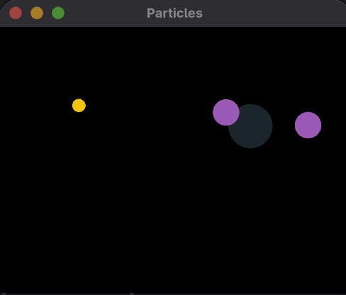

# Particle Simulation

A simple 2D particle simulation built with **C++** and **SFML 3**. The project explores graphical programming, object management, random generation, and basic physics simulation.

## Overview

The application creates colorful circular particles when the user clicks the left mouse button. Each particle has its own color, position, radius, and velocity data.

The main goal is to develop a small simulation while exploring fundamental concepts used in game development and real-time graphics programming.



## Features

- **Particle generation:** Create particles using the left mouse button.
- **Random colors:** Each particle receives a randomly selected color from a predefined palette.
- **Variable radius:** Particle size is determined by its randomly generated color index.
- **Individual particle data:** Each particle stores its own position, radius, and velocity.
- **Real-time rendering:** Particles are rendered using SFML.

## Technologies

- C++
- SFML 3
- CMake
- C++17
  
## Getting Started

### Requirements

- A C++17-compatible compiler.
- CMake 3.28 or newer.
- SFML 3.1.0.
- A compatible graphics environment.

### Build

Clone the repository:

```bash
git clone <repository-url>
cd Particle-Simulation
```

Configure the project:

```bash
cmake -B build -S .
```

Build:

```bash
cmake --build build
```

Run the executable:

```bash
./build/Particle-Simulation
```

*The executable path may vary depending on your CMake configuration.*

## Controls

| Input | Action |
|---|---|
| Left mouse button | Create a particle |
| Window close button | Exit the application |

## Project Structure

The current implementation is organized around three main components:

- **Generators:** Handles random index generation.
- **ParticlesElements:** Stores individual particle properties.
- **ParticlesManager:** Manages particle creation, simulation logic, and rendering.

## Development Roadmap

The project is still under development. Planned improvements include:

- [ ] Implement physically consistent gravity using acceleration and velocity.
- [ ] Introduce dynamic delta time using `sf::Clock`.
- [ ] Improve collision detection using particle geometry.
- [ ] Implement realistic bouncing and energy loss.
- [ ] Separate physics updates from rendering.
- [ ] Support multiple particles with independent physical behavior.
- [ ] Investigate performance optimizations for large particle counts.
- [ ] Improve portability across different machines.

## Learning Objectives

This project is intended as a practical exercise in:

- Object-oriented design and data organization.
- Vector mathematics and 2D geometry.
- Basic Newtonian mechanics.
- Collision detection and response.
- Real-time rendering.
- Performance considerations in graphical applications.

## License

This project is currently provided for educational and personal development purposes.
